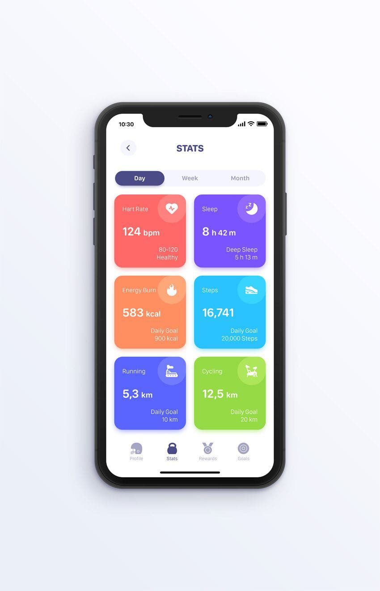
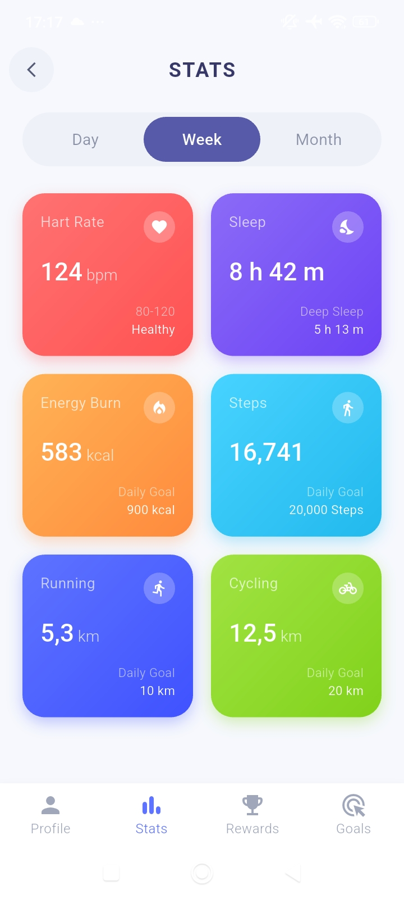

# Health Stats App




A modern Flutter UI application designed for tracking daily health metrics, fitness activities, and personal wellness goals.

## Features

- **Timeframe Filtering:** Switch seamlessly between Day, Week, and Month views.
- **Heart Rate Monitoring:** Tracks heart rate in BPM with status indicators (e.g., Healthy range).
- **Sleep Analysis:** Displays total sleep duration alongside deep sleep breakdowns.
- **Activity Metrics:** Tracks energy burn (kcal), step count, running distance, and cycling distance against daily goals.
- **Custom UI Components:** Built with custom linear gradient cards, status badges, and an integrated bottom navigation bar.

## Tech Stack

- **Framework:** Flutter (Dart)
- **UI Architecture:** Custom Stateful & Stateless Widgets with responsive GridView layout

## Getting Started

### Prerequisites

Ensure you have the following installed on your machine:
- [Flutter SDK](https://flutter.dev/docs/get-started/install)
- An IDE such as VS Code or Android Studio

### Installation & Run

1. Clone the repository:
   ```bash
   git clone [https://github.com/root0336/Health-Stats-UI-.git]
